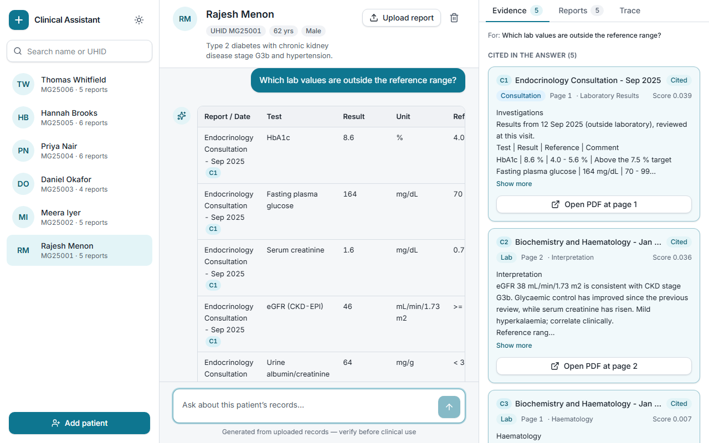
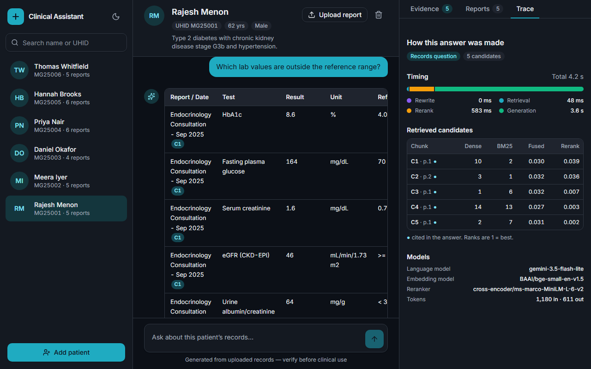
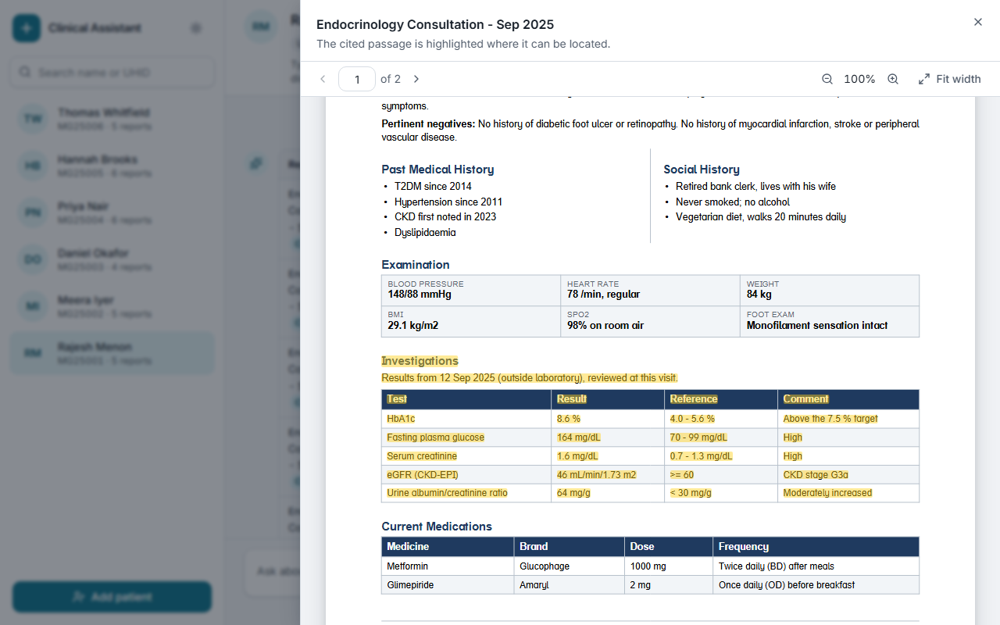
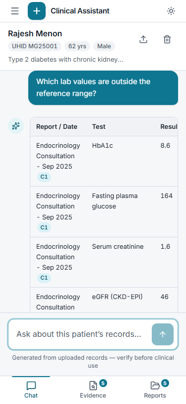
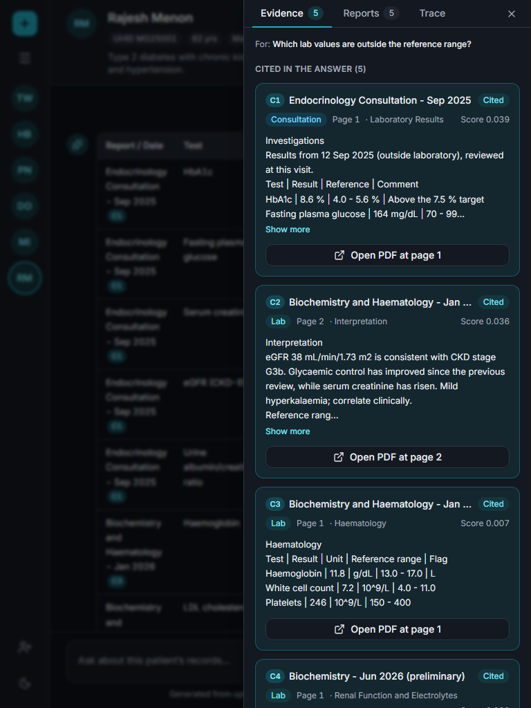
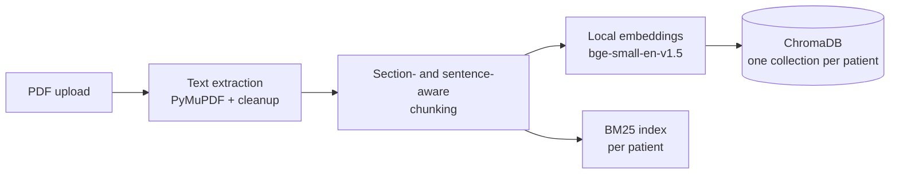
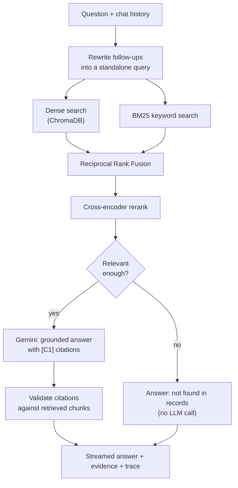

# Clinical Assistant

**Chat with a patient's medical records. Every answer is grounded in the uploaded PDFs, cites its sources, and links to the exact page.**

A local-first RAG application: a clinician selects a patient, uploads that patient's PDF reports, and asks questions in plain language. Answers stream in with clickable citations; each citation opens the source PDF on the cited page. A trace panel shows how every answer was produced (retrieval ranks, scores, timings, models).



<table>
  <tr>
    <td width="50%"><br><sub><b>Trace:</b> how each answer was made (stage timings, dense/BM25/fused/rerank scores, models, tokens)</sub></td>
    <td width="50%"><br><sub><b>Citations open the source PDF</b> on the cited page, with the cited text highlighted</sub></td>
  </tr>
  <tr>
    <td><br><sub><b>Responsive:</b> single-column mobile layout with a bottom tab bar</sub></td>
    <td><br><sub><b>Evidence:</b> cited chunks first, other retrieved chunks listed separately</sub></td>
  </tr>
</table>

> Screenshots are from the real app running against the real backend. All patient data in this repository is **synthetic**.

---

## Highlights

- **Hybrid retrieval**: dense embeddings (ChromaDB) and BM25 keyword search, merged with Reciprocal Rank Fusion. BM25 matters for drug names, doses and lab codes that embeddings blur.
- **Cross-encoder reranking** of the fused candidates before they reach the LLM.
- **Section- and sentence-aware chunking** of clinical PDFs; each chunk carries its report, page and section.
- **Relevance gate**: if nothing retrieved is relevant enough, the app says so instead of letting the model guess.
- **Citation validation**: `[C1]`-style markers are parsed and checked against what was actually retrieved; the UI shows which chunks were *cited* versus merely *retrieved*.
- **Strict patient isolation**: one vector collection per patient; a query can only ever touch that patient's data.
- **Prompt-injection hardening**: document text is passed to the model as delimited, untrusted data.
- **Conversation memory**: follow-up questions are rewritten into standalone queries before retrieval.
- **Streaming answers** over Server-Sent Events, with a stop button.
- **Observability**: every response carries a trace (stage timings, rank/score per candidate, models, token usage).
- **Local models**: embeddings and reranker run on your machine; only the final generation call goes to Gemini.

## Architecture

**Ingestion** (runs once, when a PDF is uploaded):



**Question answering** (runs for every question):



| Layer | Tech |
|---|---|
| Frontend | React 18, TypeScript (strict), Vite, Tailwind CSS, Radix UI, TanStack Query, zustand, react-pdf |
| Backend | FastAPI, Pydantic v2, SQLAlchemy 2.0 (SQLite), structlog, SSE |
| RAG | PyMuPDF, sentence-transformers (embeddings + cross-encoder), rank-bm25, ChromaDB |
| LLM | Google Gemini (`google-genai` SDK), model `gemini-3.5-flash-lite` by default |
| Tooling | uv, ruff, mypy, pytest · ESLint, Vitest, MSW, Playwright |

More detail: [architecture](docs/architecture.md) · [RAG design](docs/rag-design.md) · [evaluation](docs/eval-report.md) · [API contract](docs/api-contract.md)

## Evaluation

A golden set of 52 questions over the synthetic patients (48 answerable; the rest are unanswerable or injection tests) is in `backend/evals/data/golden.jsonl`. Retrieval is scored by whether a retrieved chunk comes from a page that contains the answer. Real results, no LLM calls involved:

| Retrieval mode | hit@1 | hit@3 | hit@5 | MRR |
|---|---|---|---|---|
| Dense only | 62.5% | 89.6% | 91.7% | 0.759 |
| BM25 only | 66.7% | 89.6% | 93.8% | 0.777 |
| Hybrid (RRF) | 64.6% | 91.7% | 93.8% | 0.773 |
| **Hybrid + rerank (default)** | **68.8%** | 87.5% | **95.8%** | **0.793** |

Reading it honestly: the full pipeline has the best hit@1, hit@5 and MRR, but the gain over BM25 alone is modest on this small, clean synthetic corpus, and the reranker slightly lowers hit@3 versus plain hybrid. The per-question-type breakdown and failure analysis are in [docs/eval-report.md](docs/eval-report.md). Reproduce with `python -m evals.run` from `backend/`.

Answer-quality checks (regex must-include / must-not-include, citation page precision, refusal on unanswerable questions, injection resistance, cross-patient leak rate) are implemented and unit-tested but **have not been run yet**; they cost about 48 Gemini calls: `python -m evals.run --answers`.

## Repository layout

```
clinical-assistant/
├── backend/                 # FastAPI service (own virtualenv, own tests)
│   ├── app/
│   │   ├── main.py          # app factory, lifespan, CORS, middleware
│   │   ├── core/            # settings, logging, error envelope
│   │   ├── api/v1/          # thin routers: health, patients, reports, chat (+SSE)
│   │   ├── services/        # business logic, file storage, per-patient locks
│   │   ├── db/              # SQLAlchemy models + session
│   │   ├── schemas/         # Pydantic request/response models
│   │   └── rag/             # the RAG package (no web imports)
│   │       ├── ingestion/   #   pdf_loader, cleaning, sections, sentences, chunker
│   │       ├── retrieval/   #   dense, bm25, fusion (RRF), reranker, relevance gate
│   │       ├── embeddings.py, vectorstore.py, llm.py, query.py
│   │       ├── prompts.py, citations.py, pipeline.py
│   ├── scripts/             # synthetic-data generator, demo seed script
│   ├── evals/               # evaluation harness + golden question set
│   └── tests/
├── frontend/                # React app (separate package.json)
├── data/synthetic/          # fictional patients + PDFs used for the demo
├── docs/                    # architecture, RAG design, eval report, API contract, screenshots
└── Makefile, scripts/       # dev tasks (scripts/dev.ps1 on Windows, scripts/dev.sh elsewhere)
```

The `rag/` package is deliberately independent of FastAPI and the database. `pipeline.py` reads top to bottom as the whole story: ingest → retrieve → rerank → gate → generate → validate citations.

## Quick start

**Prerequisites:** Python 3.11+ with [uv](https://docs.astral.sh/uv/), Node 18+, and a Gemini API key from [Google AI Studio](https://aistudio.google.com/apikey) (the free tier is enough).

### 1. Backend

```powershell
cd backend
uv sync                              # creates .venv and installs dependencies
copy .env.example .env               # then put your key in GEMINI_API_KEY
$env:HF_HOME = "$PWD\.cache\huggingface"   # keep model downloads inside the repo
.venv\Scripts\python.exe -m uvicorn app.main:app
```

API on http://localhost:8000, interactive docs at http://localhost:8000/docs. The first start downloads two small Hugging Face models (about 250 MB) into `backend/.cache/`.

### 2. Load the demo data (optional)

With the backend running, in another terminal:

```powershell
cd backend
.venv\Scripts\python.exe scripts\seed_demo.py
```

This uploads 6 synthetic patients and 27 PDFs through the real HTTP API.

### 3. Frontend

```powershell
cd frontend
npm install
npm run dev          # http://localhost:5173 (talks to the backend on :8000)
```

No backend? `npm run dev:mock` runs the full UI against in-browser mock data.

macOS/Linux: same steps with `source .venv/bin/activate`, `cp`, and `export HF_HOME=$PWD/.cache/huggingface`.

## Configuration

Set in `backend/.env` (never committed):

| Variable | Default | Purpose |
|---|---|---|
| `GEMINI_API_KEY` | none | LLM key. Without it the app runs and answers fail with a clear 502 |
| `GEMINI_MODEL` | `gemini-3.5-flash-lite` | Generation model |
| `GEMINI_BACKEND` | `studio` | `studio` (Developer API) or `vertex` |
| `GEMINI_MAX_RPM` | `8` | Client-side rate limit, sized for the free tier |
| `CORS_ORIGINS` | `http://localhost:5173` | Allow-list (a wildcard is rejected) |
| `MAX_UPLOAD_MB` | `25` | Maximum PDF size |
| `STORAGE_DIR` | `backend/storage` | SQLite DB, vectors and uploaded PDFs |
| `EMBEDDING_MODEL` / `RERANKER_MODEL` | bge-small-en-v1.5 / ms-marco-MiniLM-L-6-v2 | Local models |

Full list: [`backend/README.md`](backend/README.md).

## API overview

All routes are under `/api/v1`. The full contract (schemas, errors, SSE events) is in [`docs/api-contract.md`](docs/api-contract.md).

| Method | Path | Purpose |
|---|---|---|
| GET | `/health` | Status, configured models |
| GET / POST | `/patients` | List / create patients |
| GET / DELETE | `/patients/{uhid}` | Get / delete a patient (and their reports and vectors) |
| GET / POST | `/patients/{uhid}/reports` | List / upload PDF reports (ingested immediately) |
| DELETE | `/patients/{uhid}/reports/{id}` | Delete a report, its file and vectors |
| GET | `/patients/{uhid}/reports/{id}/file` | Serve the PDF |
| POST | `/patients/{uhid}/chat` | Ask a question, JSON response |
| POST | `/patients/{uhid}/chat/stream` | Ask a question, streamed over SSE |

## Tests

```powershell
# backend
cd backend
.venv\Scripts\python.exe -m pytest -m "not slow and not live"
.venv\Scripts\python.exe -m ruff check .

# frontend
cd frontend
npm run typecheck ; npm run lint ; npm test ; npm run build
```

Current state: backend fast suite **330 passed** with ruff clean and `mypy` (strict) clean on `app/`; frontend **70 tests passed** across 16 files, with typecheck, lint and production build all passing. Tests that load real models are marked `slow`, and tests that call the real LLM are marked `live` and are skipped by default so they never spend API quota.

## Design decisions

- **One Chroma collection per patient**: isolation is structural, not a filter someone can forget to add.
- **Explicit local embeddings**: the embedding model is pinned and recorded in each collection; a mismatch raises an error instead of silently corrupting or deleting data.
- **Hybrid + rerank over dense-only**: clinical text is full of exact tokens (`HbA1c`, `5 mg`, `B12`) where keyword search beats embeddings, and a cross-encoder fixes the ordering of near-miss candidates.
- **SQLite and `create_all`, no Alembic**: the schema is two small tables and this is a local app.
- **No auth**: a deliberate scope limit for a local portfolio project; it would be the first thing to add for real use.

## Limitations and next steps

- **Answer-quality evaluation** is implemented but not yet run (see Evaluation). Published numbers cover retrieval only.
- The golden set is small and synthetic; treat the retrieval numbers as a regression baseline, not a benchmark.
- Scanned (image-only) PDFs are rejected; there is no OCR step.
- Single user, no authentication, local deployment only.
- Not a medical device and **not medical advice**. Answers are generated from the uploaded documents and must be verified by a clinician.

## Data

Every patient, report and value in this repository is fictional and produced by `backend/scripts/generate_synthetic_data.py` (deterministic seed). No real patient data is included or should be uploaded.
