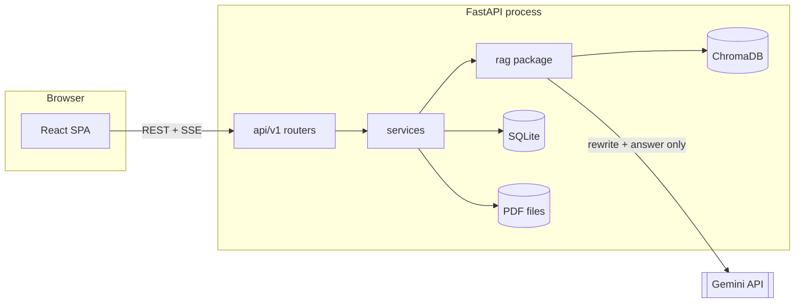
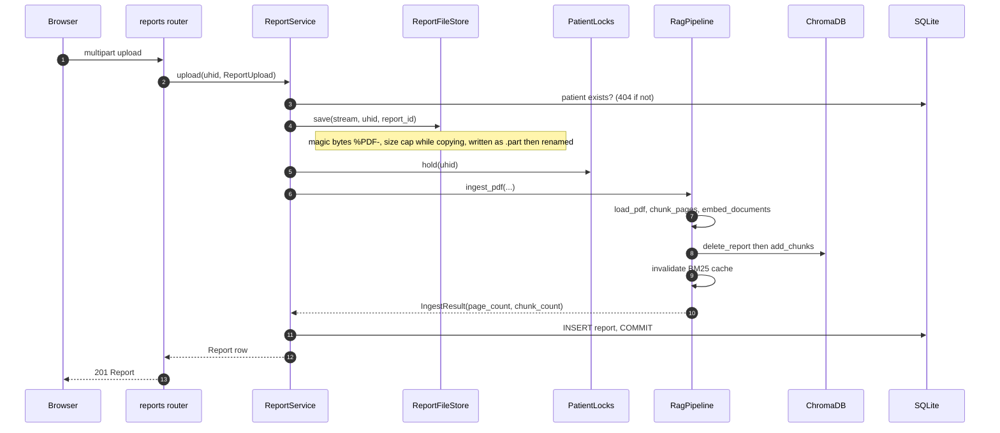
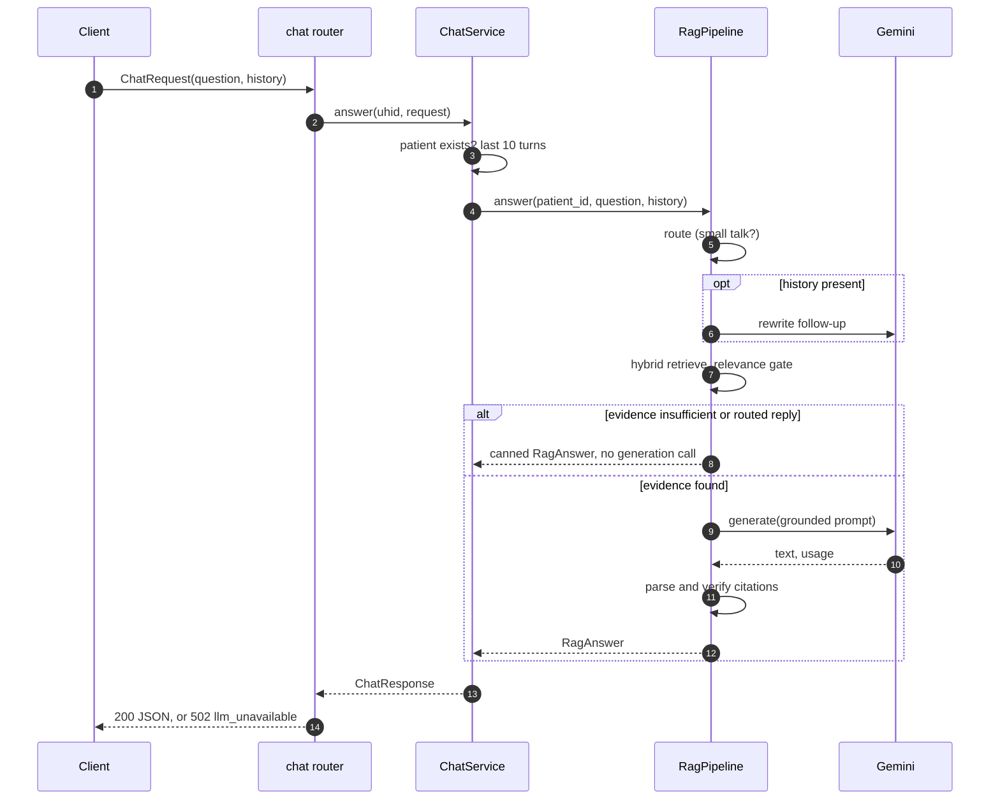
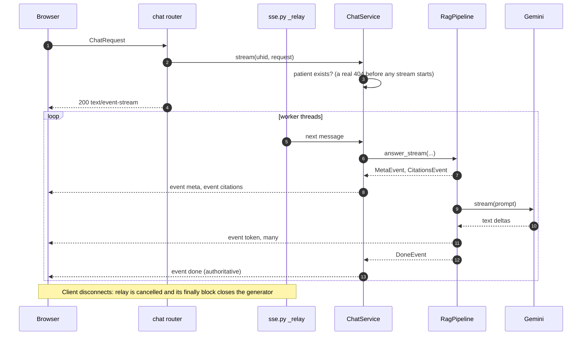
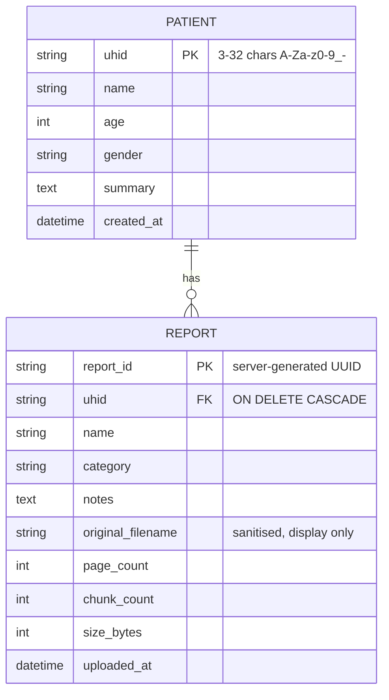

# Architecture

How Clinical Assistant is put together: layers, request lifecycles, data, errors, concurrency,
configuration and the frontend. The HTTP contract itself lives in [`api-contract.md`](api-contract.md);
the retrieval pipeline is explained stage by stage in [`rag-design.md`](rag-design.md).

Scope: a single-user, local-only app. There is no authentication, no deployment target and no
multi-process coordination; those limits are deliberate and are listed at the end.

## System overview



Embeddings and the reranker run inside the backend process on the local machine. Only the query
rewrite (for follow-ups) and the final answer generation leave the machine, and what they carry
is the question, a short history and the top retrieved excerpts of one patient.

## Backend layers

```
backend/app/
  main.py        create_app() factory, lifespan, middleware order, CORS
  core/          settings, structured logging, request middleware, error envelope
  api/           thin routers (api/v1), dependency wiring (deps.py), SSE bridge (sse.py)
  schemas/       Pydantic request/response models: the wire format
  services/      use-cases: patients, reports, chat; file storage; per-patient locks
  db/            SQLAlchemy 2.0 models, engine and session factory
  rag/           the retrieval pipeline; imports nothing from FastAPI or SQLAlchemy
  state.py       AppState: the collaborators built once at startup
  domain.py      vocabulary shared by db and api (Gender, ReportCategory, UHID pattern)
```

Dependencies point one way: `api -> services -> (db, rag via RagPort)`. Each layer has one job.

| Layer | Responsibility | Deliberately does not |
|---|---|---|
| `api/v1` | Parse and validate the request, choose the HTTP status, return the schema | Contain business logic or touch the filesystem |
| `api/deps.py` | The only place services are assembled (`PatientService`, `ReportService`, `ChatService`) | Hold state |
| `services/` | Transactions, file handling, locking, mapping RAG results onto schemas | Know about HTTP requests |
| `services/ports.py` | `RagPort` Protocol: the slice of the pipeline the API depends on | Import ML libraries |
| `db/` | Two tables, SQLite pragmas, session factory | Hold business rules |
| `rag/` | Ingest, retrieve, generate, verify citations, build the trace | Import web or ORM code |

Why a Protocol between services and the pipeline: the web layer starts and is fully testable
without loading torch or models. The API tests run against `tests/fakes.py::FakePipeline`; the real
pipeline is imported only inside `build_rag_pipeline()` in `main.py`. The RAG package has its own
Protocols for each heavy collaborator (`Embedder`, `Reranker`, `LLMClient`, `VectorStore`), so its
tests inject scripted fakes the same way.

Responsibilities of the supporting modules:

- `core/config.py`: `Settings` (pydantic-settings). `rag_settings()` translates it into the plain
  frozen `RagSettings` dataclass, so `rag/` never depends on pydantic-settings.
- `core/errors.py`: `AppError` subclasses and the handlers that render the error envelope.
- `core/middleware.py`: `RequestContextMiddleware` (request id, access log, last-resort 500) and
  `BodySizeLimitMiddleware` (rejects an oversized declared `Content-Length` before parsing).
- `services/storage.py`: `ReportFileStore`, the only code that touches report files.
- `services/locks.py`: `PatientLocks`, per-patient mutual exclusion.
- `api/sse.py`: bridges the synchronous pipeline generator to an `EventSourceResponse`.

Startup (`lifespan` in `main.py`): create the SQLite engine and tables, create the reports
directory, build the pipeline, run `pipeline.warmup()` on a worker thread unless `SKIP_WARMUP` is
set, then publish an `AppState` (settings, session factory, pipeline, file store, locks) on
`app.state`. Middleware is added innermost first, so the order outside-in is CORS, request context,
body-size limit; a 500 therefore still carries CORS headers and the browser shows the API error
instead of an opaque network failure.

## Request lifecycles

### Upload and ingestion

`POST /api/v1/patients/{uhid}/reports` (multipart: `file`, `name`, `category`, `notes?`).



The file, the vectors and the row are created in that order, and the row is the commit point.
If anything fails, `_discard` rolls the session back, deletes the vectors and removes the file, so
a failed upload leaves no trace. `NoExtractableTextError` becomes 400 `no_extractable_text`,
`InvalidPdfError` becomes 400 `invalid_pdf`; the file-type and size checks happen before ingestion
(415 `unsupported_media_type`, 413 `file_too_large`).

Deleting a report or a patient follows the same discipline in reverse: hold the lock, delete the
row inside a transaction, delete the vectors, commit, and only then remove files. If the vector
delete fails the row delete is rolled back, so the two stores never disagree; files go last and
are best-effort because nothing references them any more.

### Chat, JSON

`POST /api/v1/patients/{uhid}/chat`: the simple request/response form of the same pipeline.



### Chat, SSE

`POST /api/v1/patients/{uhid}/chat/stream`: the UI uses this one. It is a POST, so the browser's
`EventSource` cannot be used; the frontend reads the `fetch` body stream instead (see below).



Event order is `meta`, `citations`, many `token`, then `done` (or a terminal `error`).
`done` carries the complete `ChatResponse` and is authoritative: the UI replaces everything it
streamed with it, because only after generation are citation markers verified and the `cited`
flags set. Greetings, off-topic asks and insufficient-evidence replies emit `meta`, an empty
`citations` list, one `token` with the whole canned text and `done`, without calling the
generator. For an insufficient-evidence reply the trace has `insufficient_evidence: true` and no
candidates, because the plan drops the weak ones.

## Data model



- SQLite via SQLAlchemy 2.0 typed models (`db/models.py`). Tables are created with `create_all` at
  startup; there is no Alembic because the schema is two small tables. `UTCDateTime` stores
  timezone-aware UTC and rejects naive datetimes. Each connection sets `foreign_keys=ON`,
  `journal_mode=WAL` and `synchronous=NORMAL`; WAL lets chat reads proceed while an upload writes.
- `report_count` on a patient is a derived property, not a column.
- Vectors live in ChromaDB, outside the relational model. One collection per patient, named
  `patient_<uhid>` (a `.x` suffix is appended when the UHID ends in `-` or `_`, because Chroma names
  must end alphanumerically). Collection metadata records the embedding model and `hnsw:space=cosine`.
- A chunk is stored with `id = "<report_id>:<index>"`, the verbatim chunk text as the document and
  metadata `report_id`, `report_name`, `category`, `page`, `section`. Search results carry no
  scores from Chroma; rank is list position, and every score shown to the user comes from fusion or
  the reranker.
- The PDF files are the source of truth for the viewer; the chunks are a derived index.

## Error model

Every failure answers with one envelope, so the client parses a single shape:

```json
{ "error": { "code": "snake_case_code", "message": "Human readable text." } }
```

| Status | Code | Raised by |
|---|---|---|
| 400 | `no_extractable_text`, `invalid_pdf` | `ReportService.upload` (translated from RAG errors) |
| 404 | `not_found` | missing patient, report, or report file; unknown route |
| 405 | `method_not_allowed` | unsupported method on a route |
| 409 | `patient_exists` | duplicate UHID |
| 413 | `file_too_large` | `BodySizeLimitMiddleware` or `ReportFileStore.save` |
| 415 | `unsupported_media_type` | upload is not a PDF (magic bytes, not the extension) |
| 422 | `validation_error` | request validation; all problems joined into one message |
| 502 | `llm_unavailable` | `LLMUnavailableError` (not configured, rate limited, daily quota, unreachable) |
| 500 | `internal_error` | anything unexpected; a fixed message, never a stack trace or path |

How it is implemented: `AppError` subclasses (`core/errors.py`) carry a status and a code and are
rendered by one handler; validation and Starlette HTTP errors have their own handlers; anything
else reaches `RequestContextMiddleware`, which logs it with the request id and answers 500. Each
response has an `X-Request-ID` header (a supplied id is kept only if it is safe), which also
appears in the access log, so a user-visible failure can be matched to a log line.

Streaming cannot change the HTTP status after the first byte, so failures during a stream become
a terminal `error` event with the same `code` and `message`; `ChatService._stream_events` and
`RagPipeline.answer_stream` both guarantee a stream ends with `done` or `error`.

Known gap: `EmbeddingModelMismatchError` (the stored collection was built with another embedding
model) is only translated to a precise code on the streaming path. On the JSON chat route and on
upload it surfaces as 500 `internal_error`; the message is in the server log.

## Concurrency and threading

- Routes are plain `def` functions, so FastAPI runs each on a worker thread from its threadpool
  and the event loop stays free. The synchronous pipeline (torch, Chroma, blocking HTTP to Gemini)
  never runs on the loop. Startup warm-up also runs through `run_in_threadpool`.
- One SQLAlchemy `Session` per request (`get_session` dependency). SQLite is opened with
  `check_same_thread=False` and WAL.
- **Per-patient locks** (`PatientLocks`): ingest and delete (of a report or of a patient) hold a
  `threading.Lock` keyed by UHID. A Chroma collection must not have two writers, and an upload
  spans several steps (embed, write vectors, commit row) that must not interleave with a delete of
  the same patient. Different patients run in parallel. Chat and listing do not take the lock, so
  reads stay available during an upload. The lock table is in memory and never pruned, which is
  acceptable for a local app with a bounded number of patients.
- **BM25 index cache**: built lazily per patient from the stored chunks under its own `Lock`, and
  dropped (`invalidate`) by the pipeline after every ingest or delete. A question that is answered
  while an upload is in flight may use the index from just before it; the next one sees the new chunks.
- **LLM rate limiter**: one process-wide sliding-window `RateLimiter` (default 8 requests per
  minute, below the free tier's 10). `acquire()` blocks the calling worker thread, never the event
  loop, and sleeps outside its internal lock.
- **SSE and disconnects**: `api/sse.py` iterates the generator with `iterate_in_threadpool`, one
  `next()` per hop to a worker thread. When the client disconnects, the response coroutine is
  cancelled and its `finally` block calls `close()` on the generator. That raises `GeneratorExit`
  inside the pipeline at its current `yield`, which closes the Gemini stream. If a worker is still
  inside `next()`, `close()` raises `ValueError`, which is suppressed; the generator is reclaimed
  as soon as that call returns. Clicking Stop in the UI aborts the `fetch`, which is the same path.
- The pipeline's lazy models are loaded once; warm-up at startup avoids two first requests
  racing to initialise them.

## Configuration

All settings come from environment variables or `backend/.env` (`core/config.py`); names are the
upper-case form of the field. `.env.example` lists the common ones; the key is never committed.

| Variable | Default | Purpose |
|---|---|---|
| `GEMINI_API_KEY` | unset | LLM key; without it the API runs and answers fail with 502 |
| `GEMINI_MODEL` | `gemini-3.5-flash-lite` | generation model |
| `GEMINI_BACKEND` | `studio` | `studio` (Gemini Developer API) or `vertex`; never inferred from the key |
| `GEMINI_MAX_RPM` | `8` | client-side request cap per minute |
| `CORS_ORIGINS` | `http://localhost:5173` | comma-separated allow-list; `*` is rejected at startup |
| `MAX_UPLOAD_MB` | `25` | hard cap per PDF (1 to 500) |
| `STORAGE_DIR` | `backend/storage` | database, vectors and PDFs |
| `HF_CACHE_DIR` | `backend/.cache/huggingface` | local model cache |
| `EMBEDDING_MODEL` | `BAAI/bge-small-en-v1.5` | dense retrieval model |
| `RERANKER_MODEL` | `cross-encoder/ms-marco-MiniLM-L-6-v2` | cross-encoder |
| `MIN_RERANK_SCORE` | RAG default (`0.001`) | relevance gate override; re-calibrate when the reranker changes |
| `SKIP_WARMUP` | `false` | do not load models at startup |
| `LOG_LEVEL`, `LOG_JSON` | `INFO`, `false` | structlog level and format |

Retrieval parameters (`chunk_tokens=300`, `chunk_overlap_tokens=50`, `dense_k=20`, `bm25_k=20`,
`rerank_top_n=5`, `history_turns=6`, `retrieval_mode=hybrid_rerank`) are fields of `RagSettings`
with the defaults from the contract. They are not exposed as environment variables on purpose:
changing them changes retrieval quality and should be a reviewed code change evaluated against the
golden set. `retrieval_mode` (`dense`, `bm25`, `hybrid`, `hybrid_rerank`) exists so evaluations can
ablate each stage.

The history window narrows in two places: the UI sends at most 10 turns, `ChatService` keeps the
last 10, and the pipeline uses the last 6 (`history_turns`) for rewriting and the prompt.

## Storage layout

Everything generated lives under `backend/` and is gitignored:

```
backend/
  storage/
    app.db                           SQLite (+ -wal, -shm sidecar files)
    chroma/                          ChromaDB persistent client
    reports/<uhid>/<report_id>.pdf   uploaded files, server-generated names
  .cache/
    huggingface/                     embedding and reranker models (HF_HOME)
    uv/                              uv package cache
  .venv/                             Python environment
frontend/
  node_modules/, .playwright/        npm packages and test browsers
```

Paths are only ever built from a validated UHID and a server-generated UUID
(`ReportFileStore.path_for` refuses anything else), the client-supplied file name is sanitised and
used for display only, and a report is looked up by `(uhid, report_id)` so another patient's id is
a 404. To start from a clean slate, stop the server and delete `backend/storage/`.

## Frontend architecture

React 18, TypeScript (strict), Vite, Tailwind, Radix primitives. It talks to the backend only
through `src/api/`.

```
frontend/src/
  app/         providers, router, responsive shell (AppShell), pages (HomePage, PatientPage)
  api/         fetch client + ApiError, zod schemas, endpoints, query hooks, POST-SSE client
  features/    patients, reports, chat, evidence, trace, pdf, workspace  (one folder per feature)
  components/  shared building blocks; components/ui holds the small primitives
  hooks/ lib/  breakpoint, theme, formatting and other helpers
  mocks/       MSW handlers implementing the contract (tests and `npm run dev:mock`)
```

**Feature folders.** Each folder owns its components, its state and its tests: `chat` (message
list, composer, markdown rendering with citation chips, `streamRunner`, `chatStore`), `evidence`
(retrieved excerpts, cited first), `trace` (the "how this answer was made" panel: candidate table
with dense/BM25/fused/rerank values and a timing bar), `pdf` (viewer sheet, page view, highlight),
`reports` (library, upload dialog), `patients` (list, header, add dialog), and `workspace` (the
inspector with its Evidence, Reports and Trace tabs, and UI-only state).

**API layer** (`src/api/`).
- `client.ts` is the single `fetch` wrapper. It normalises every failure into an `ApiError` with
  `status`, `code` and `message` taken from the error envelope; an unreachable server becomes
  `network_error` with status 0.
- `schemas.ts` holds zod schemas mirroring the contract. Every response is parsed, so the rest of
  the app only sees validated, typed data and a contract drift fails loudly at the boundary.
- `endpoints.ts` is the typed list of calls; `hooks/` wraps them in TanStack Query hooks with one
  key factory (`keys.ts`). Mutations invalidate the patient, patients and reports queries together
  because the report count lives on the patient.
- `queryClient.ts` retries only transient failures (never 4xx) and toasts mutation errors unless
  the caller shows them inline (`meta.silent`, used by the upload dialog).

**SSE client** (`api/sse.ts`, `api/chatStream.ts`). Because the chat stream is a POST,
`parseSse` reads the `fetch` response body, decodes UTF-8 incrementally, splits on blank lines and
yields `{event, data}` messages. `streamChat` validates each with zod and yields typed events
(`citations`, `token`, `done`, `error`); the optional `meta` event is skipped; a malformed payload
becomes an `ApiError`. Aborting the `AbortSignal` ends the stream, which the server sees as a
disconnect.

**State.** Server state is TanStack Query (patients, reports, health, PDF blobs). Client state is
two small zustand stores, both in memory only:
- `chatStore`: one session per UHID (messages plus the answer the inspector describes). Patient
  conversations are never written to browser storage.
- `workspaceStore`: inspector tab and open state, dialogs, and the PDF target.
`streamRunner` lives outside React and keeps one `AbortController` per patient, so an answer keeps
arriving into the right conversation even if the clinician switches patients mid-stream. On `done`
it replaces the streamed text with the authoritative answer, citations and trace.
`history.ts` sends only finished messages, at most the last 10 turns.

**Citations to PDF.** `citations.ts` turns `[C1]` markers into markdown links with a private
`cite:` scheme before rendering; `AnswerMarkdown` swaps those for `CitationChip`s. Going through
react-markdown (no raw HTML) keeps the output sanitised by construction. Clicking a chip calls
`useOpenCitation`, which stores a `PdfTarget` (report, page, cited text); the lazily loaded
`PdfViewerSheet` fetches the PDF through the API client, renders the page with react-pdf and
`highlight.ts` marks the text-layer items that occur inside the cited chunk.

**Responsive shell.** `useBreakpoint` selects one layout rather than hiding two: below 768px a top
bar, bottom tab bar and an inspector that replaces the chat; 768 to 1279px an icon rail and a
slide-over inspector; from 1280px the patient sidebar, chat and a docked inspector. The shell is
capped at 2000px so ultra-wide screens keep readable line lengths.

**Mock mode.** `VITE_USE_MOCKS=true` (or `npm run dev:mock`) starts an in-browser MSW worker that
implements the contract, so the UI runs without a backend; the same handlers back the Vitest
suite.

## Testing seams

- Backend API and services: `tests/api`, `tests/services` run the real app with temporary
  storage and `FakePipeline` (no models).
- RAG package: `tests/rag` uses small fakes for the embedder, store, reranker and LLM.
- `pytest -m slow` (or `RUN_SLOW=1`) loads the real embedding and reranker models;
  `RUN_LIVE=1` enables the tests that call the real Gemini API. Both are skipped by default.
- Frontend: Vitest with Testing Library and MSW; Playwright for end-to-end flows, axe
  accessibility scans and the screenshots in `docs/screenshots/`.

## Known limits

- No authentication or authorisation, and no audit log. Anyone who can reach the port can read
  every patient. Not suitable for real patient data as it stands.
- One process. The per-patient locks and the BM25 cache are in memory, so running several
  backend workers against one `storage/` directory is unsupported.
- No migrations: changing a model means resetting `backend/storage/` or altering the table by hand.
- Changing the embedding model requires re-ingesting every report; the app refuses to mix vector
  spaces instead of deleting data.
- No OCR: scanned PDFs are rejected with `no_extractable_text`.
